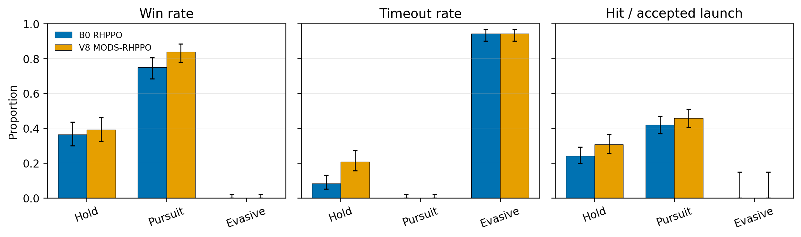
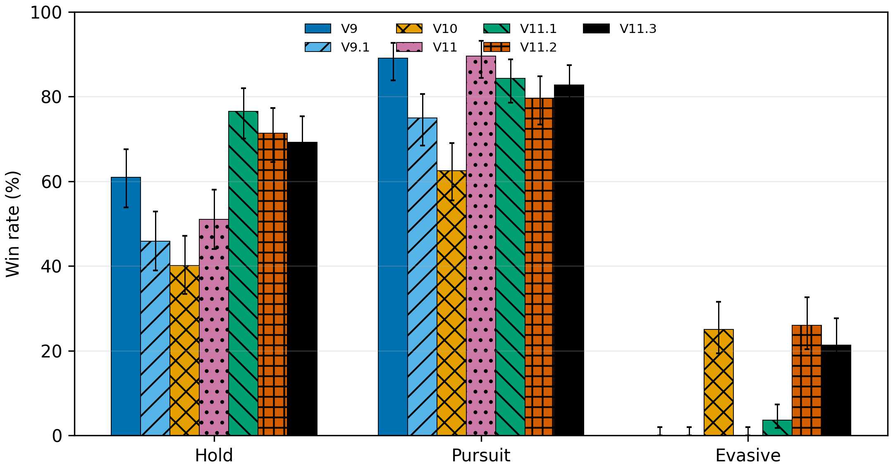
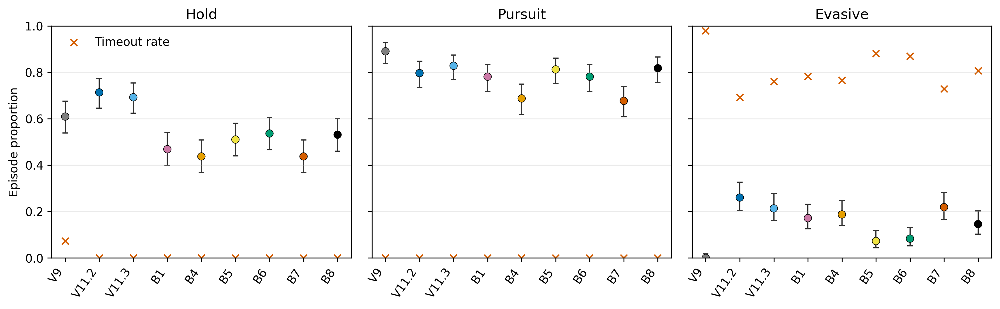
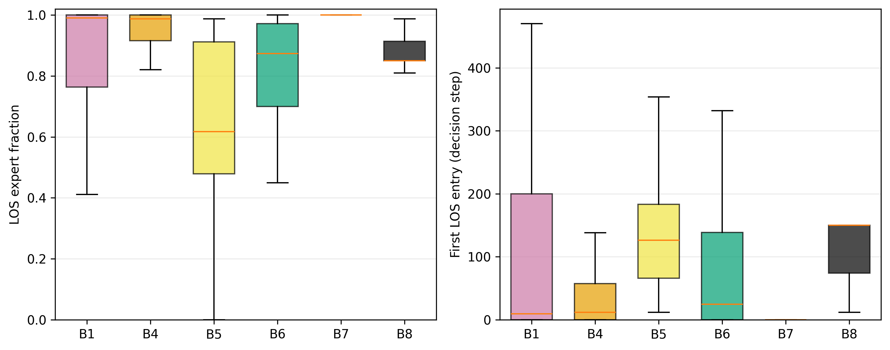

# DRVOI-RHPPO / Round 12 / 导师决策汇报 / 2026-11-07

> 汇报目的：系统梳理当前平台、DRVOI-RHPPO 系列和 V9–V12 分层控制实验，明确哪些结论已经有数据支持、哪些仍然只是开发现象，并请导师决定是否继续算法创新以及后续论文主线。

## 1. 执行摘要

目前平台的工程训练链路已经基本稳定：Torch GPU 六自由度动力学和导弹模型可以在 60 Hz 下批量运行；V12 百万步训练的实测吞吐约为 1.68–1.75k 环境决策/s，1,007,616 步耗时约 644 s；固定对手评估中的武器请求合法率均为 100%，未观察到坠毁或数值异常。因此，近期算法退化不能简单归因于武器发射流程、环境崩溃或训练速度不足。

算法层面的核心发现是：V7.1 证明动作历史对未来相对状态具有可预测信息，但 V7.1–V7.3 没有证明该信息能够稳定支持精确动作价值选择；V8 的 soft-VOI 改善了 Pursuit 局部效率，却没有解决 Evasive 零胜率；V9 在 Hold/Pursuit 上较强，但 Evasive 仍为 0%；V10–V11 的实验进一步证明，Evasive 并非环境不可解，真正关键的是超前拦截 option 的语义和持续时间。V11.2/V11.3 因而成为当前最强的开发基线。

V12 的可达性预测器具有很高的短时域预测性能，但“形成合法发射机会”与“获得终局胜利”并不等价。A6/A7 修复在线状态覆盖后，B6 的 Evasive 门控允许率恢复到 77.20%，胜率却只有 8.33%；B7/B8 的持续化处理能够部分恢复 Evasive，但会损害 Hold/Pursuit，仍未超过 V11.2/V11.3 的综合表现。

因此，当前最稳妥的决定是：

1. 停止继续微调 V12-B4～B8 的门控阈值、锁存时间和成本权重；
2. 保留 V11.2/V11.3 作为强开发基线，保留 A6/A7 数据与模型作为后续机制工具；
3. 如果论文目标仍是一区 Top 期刊，可以允许一次有明确预算和停止规则的新核心假设检验，但不再沿用当前二值门控路线；
4. 如果论文目标以毕业和稳健实验为主，则应停止新增算法版本，立即转向多训练种子、未见对手族、平台物理验证和论文整理。

## 2. 实验身份与决策背景

本阶段研究试图回答三个逐步收敛的问题：

1. 动作条件的对手/相对状态预测信息是否存在；
2. 预测信息是否能够转化为可靠的反事实动作价值；
3. 当精确动作价值不可用时，能否通过分层 option、可达性专家和时序仲裁提高近距空战能力。

研究版本从 V6 延伸到 V12，但这些版本不应被理解为十二次独立确认性实验。V6–V8 主要研究响应预测与 VOI，V9–V11 研究分层 option 和持续仲裁，V12 研究模型驱动可达性、门控和终止。多个结构是在同一开发评估分布上顺序提出的，因此存在明显的开发集选择偏差。

当前需要导师决定的不是“再调哪一个参数”，而是以下更高层问题：

- DRVOI/VOI 是否仍必须作为论文主创新；
- 是否允许最后一次从二值门控转向“对手行为信念＋交战阶段＋持续战术 option”的结构重构；
- 或者是否应冻结算法主线，把现有工作收敛为平台、分层控制、机制分析和严谨负结果。

## 3. 平台与评估协议

### 3.1 当前平台状态

- 动力学与导弹模型：Torch GPU 批量实现，物理仿真频率保持 60 Hz；
- 并行训练：典型配置为 96 个环境；
- V12 训练吞吐：约 1.68–1.75k 环境决策/s；
- 百万步训练耗时：约 643.6–644.4 s；
- 武器链：纳入本报告的固定对手评估中，武器请求合法率为 100%；
- 稳定性：纳入本报告的评估未发生坠毁或数值崩溃；
- 测试：V12 当前状态文档记录 27 项专项测试通过。

上述结果支持“平台具备稳定开展算法开发实验的工程条件”，但不能替代气动、发动机、飞控和导弹包线相对 JSBSim 或其他可信平台的外部验证。

### 3.2 固定对手评估协议

- 对手：Hold、Pursuit、Evasive 三类固定脚本；
- 每个方法、每类对手：192 局；
- 红蓝位置：红方 96 局、蓝方 96 局；
- 开发评估种子：10085；
- 主要指标：胜率；
- 辅助指标：超时率、命中/发射、合法发射率、专家介入率、option 持续时间和训练吞吐。

V12 新评估同时保存逐局 JSONL、option 分段、初始状态哈希、颜色和武器链信息，可以支持同初始状态的冻结策略配对诊断。

### 3.3 统计单位

算法级比较的正确独立单位是训练随机种子。目前 V8–V12 的主要结构比较只有训练种子 85，因此训练重复数为 `n=1`。每类对手的 192 局只能描述一个冻结 checkpoint 在当前评估分布中的表现，不能替代 192 次独立训练，也不能据此声称算法具有统计显著优越性或种子鲁棒性。

## 4. 实验链与主要发现

### 4.1 V6–V7.3：预测信息存在，但精确动作价值不可识别

| 阶段 | 主要数据 | 当前解释 |
|---|---:|---|
| V7.1 历史响应 | 平均 ΔNLL/维 0.05059；5/5 外层 fold 为正；90% 区间覆盖率 0.90679 | 三步动作历史确实包含可预测的未来相对状态信息 |
| V7.1 P1Q | 完整终局排序准确率 0.501；归一化 argmax 遗憾 0.464 | Q 主要学习状态整体好坏，不能可靠选择同状态下的最优动作 |
| V7.2 状态充分性 | 机械 oracle 排序 0.506；遗憾 0.435 | 增加未来 belief、观测和低层隐藏状态仍未解决价值可识别性 |
| V7.3 时间尺度 | 12 步排序最高约 0.654，但遗憾仍约 0.271 | 局部动作趋势可部分学习，精确 argmax 仍不可靠 |

这条证据链改变了最初假设：预测模型显著并不自动意味着决策信息价值可用。继续增加当前 90 动作 Q 的数据量、网络宽度或训练轮次，缺少新的实证依据。

### 4.2 V8：soft-VOI 有局部收益，但不能解决困难对手

V8 训练 1,007,616 步后，相对 B0：Pursuit 胜率从 75.00% 上升到 83.85%，命中/发射增加 3.91 个百分点；Hold 胜率只提高 2.60 个百分点，但超时率增加 12.50 个百分点；Evasive 仍为 0% 胜率和 94.27% 超时率。

训练末期正 VOI 覆盖率从 52.6% 下降到 24.8%，候选宏选项分歧从 38.6% 下降到 14.6%，说明冻结离线价值模型逐渐偏离在线策略访问分布。由此停止将 VOI 直接作为逐步内在奖励。

### 4.3 V9–V11.3：困难场景的关键在 option 语义和持续性

| 方法 | Hold 胜率 | Pursuit 胜率 | Evasive 胜率 | 宏平均胜率 | 宏平均超时率 |
|---|---:|---:|---:|---:|---:|
| V9 COACH-RHPPO | 60.94% | **89.06%** | 0.00% | 50.00% | 35.07% |
| V9.1 high/low PPO | 45.83% | 75.00% | 0.00% | 40.28% | — |
| V10 BARC-RHPPO | 40.10% | 62.50% | 25.00% | 42.53% | — |
| V11 单步仲裁 | 51.04% | 89.58% | 0.00% | 46.88% | — |
| V11.1 滞回仲裁 | **76.56%** | 84.38% | 3.65% | 54.86% | — |
| V11.2 整局锁定 | 71.35% | 79.69% | **26.04%** | **59.03%** | **23.09%** |
| V11.3 持续证书 | 69.27% | 82.81% | 21.35% | 57.81% | 25.35% |

独立审计中，纯追击对 Evasive 为 0/192，而 LOS 超前拦截为 48/192。V10 强制采用 LOS 后同样达到 25% 胜率，说明 Evasive 场景在当前动力学、动作空间和武器模型下可解，失败不是环境完全无法截获。

V11 单步仲裁即使在 Evasive 上达到较高介入率仍为零胜；V11.2 将 option 保持到整局后达到 26.04%；V11.3 用连续 12 个决策步的证书触发达到 21.35%，并改善对简单对手的保持。数据支持“持续时间和终止逻辑比单步触发分数更关键”，但不支持“12 步为全局最优”。

### 4.4 V12：预测准确不等于策略有效

V12 A1 采集 50,016 个状态、299,616 个主轨迹决策和 14,442,849 个反事实模型分支决策。A2 短时域可达性模型在测试集达到 AUROC 0.9847、AUPRC 0.9168、Brier 0.0200、ECE 0.0093、Spearman 0.9793。它能预测短时域内是否形成合法发射机会，但该目标不等同于终局获胜。

A6/A7 又采集 20,064 个在线状态、119,904 个在线决策和 10,794,478 个模型分支决策。A7 整体优势符号准确率为 68.02%，Evasive 为 82.91%；但经验 LCB 覆盖率只有 81.32%，低于预期的 90% 校准目标，不能解释为正式置信保证。

V12 固定对手结果如下：

| 方法 | Hold | Pursuit | Evasive | 宏平均胜率 | 宏平均超时率 |
|---|---:|---:|---:|---:|---:|
| B1 Frozen | 46.88% | 78.13% | 17.19% | 47.40% | 26.04% |
| B2 Cost | 39.58% | 61.98% | 25.00% | 42.19% | 23.09% |
| B3 Shield-only | 50.00% | 81.25% | 7.29% | 46.18% | 29.34% |
| B4 Return-gated | 43.75% | 68.75% | 18.75% | 43.75% | 25.52% |
| B5 Behavior-gated | 51.04% | 81.25% | 7.29% | 46.53% | 29.34% |
| B6 On-policy gated | 53.65% | 78.13% | 8.33% | 46.70% | 28.99% |
| B7 Gate-latched | 43.75% | 67.71% | 21.88% | 44.44% | 24.31% |
| B8 SPRT-latched | 53.13% | 81.77% | 14.58% | 49.83% | 26.91% |

B6 将在线 Evasive 门控允许率恢复到 77.20%，但胜率仅为 8.33%，说明状态覆盖修复并不等于控制效果修复。B7 将 Evasive 提高到 21.88%，却把 Hold/Pursuit 降至 43.75%/67.71%；B8 恢复 Pursuit 到 81.77%，Evasive 又降至 14.58%。当前 V12 方法均未在 Hold、Pursuit、Evasive 三个维度上支配 V11.2/V11.3。

## 5. 统计验证与证据边界

### 5.1 当前能够支持的结论

1. 在当前开发分布上，V11.2/V11.3 相对 V9 恢复了 Evasive 非零胜率，并提高了三场景描述性宏平均胜率；
2. 当前 Evasive 失败与纯追击、option 语义丢失和持续时间不足有关；
3. V12 的在线数据聚合修复了门控覆盖漂移，但没有单独恢复控制性能；
4. 在冻结 B6 checkpoint 上，B7 相对 B6 的 Evasive 配对胜率差为 +12.70 个百分点，Holm 校正后的精确检验 `p=0.0002`；B8 相对 B6 为 +6.28 个百分点，校正后 `p=0.0084`。这些结果支持固定策略下的结构诊断；
5. 所有纳入比较的 V12 评估武器请求合法率均为 100%，因此负结果不由非法发射或崩溃解释。

### 5.2 当前不能支持的结论

1. 不能声称 V11.2、V11.3 或 V12 在算法层面显著优于 PPO/RHPPO；
2. 不能声称任何方法对训练随机种子鲁棒，因为核心比较只有一个训练种子；
3. 不能把冻结 checkpoint 的 192 局 Wilson 区间解释为算法跨种子的置信区间；
4. 不能把三个固定脚本的结果解释为未知对手或策略种群上的泛化；
5. 不能把 A2/A7 的预测准确率直接解释为策略收益；
6. 不能把反复使用开发评估种子 10085 后得到的结构选择，当作独立确认性结果。

## 6. 图表逐图解读

### 图 1：V8 与 B0 的固定对手比较

- 图表目的：判断 soft-VOI 是否同时改善容易对手和困难对手；
- 关键观察：Pursuit 胜率上升，但 Hold 超时增加，Evasive 完全没有恢复；
- 支持的解释：逐步 VOI 奖励可能改善局部效率，但没有把信息价值与真正执行的持续动作绑定；
- 决策影响：停止继续放大 V8，转向实际执行的高层 option。

### 图 2：V9–V11.3 胜率比较

- 图表目的：比较纯学习 option、强制专家和不同持续仲裁结构；
- 关键观察：V11.2/V11.3 首次同时保持较高 Hold/Pursuit 并恢复 Evasive；
- 支持的解释：超前拦截 option 的持续性是当前困难场景的主要机制候选；
- 决策影响：把 V11.2/V11.3 作为后续结构必须超过的基线，而不是继续与较弱的 V9 单独比较。

### 图 3：V12 胜率和超时率

- 图表目的：检验回报门控、在线聚合和时序证据是否形成新的 Pareto 改进；
- 关键观察：B6 修复覆盖但未恢复胜率，B7/B8 在困难场景和简单场景之间反复交换性能；
- 支持的解释：当前二值门控证据不足以决定何时采用持续专家；
- 决策影响：停止 B4–B8 的参数迭代，不扩大到百万步。

### 图 4：V12 Evasive 机制分布

- 图表目的：判断 LOS option 的占用率和进入时机是否解释 Evasive 结果；
- 关键观察：高 LOS 占用本身不足以获得胜利，成功与失败还取决于何时进入并持续执行；
- 支持的解释：需要建模时序阶段和持续决策，而不是只输出逐步二值开关；
- 决策影响：若继续创新，应转向阶段条件化的持续 option，而不是调整单步门控阈值。

## 7. 失败结果、风险与限制

### 7.1 已经基本证伪或不建议继续的路线

- 当前 90 动作上的精确 argmax DRVOI；
- 把 soft-VOI 直接作为逐步内在奖励；
- 无持续性的单步专家切换；
- 只依靠可达性 shield 解决困难对手；
- 继续微调 B4–B8 的门控阈值、成本和锁存长度；
- 在没有多训练种子前直接启动 1000 万步大规模对比。

### 7.2 当前主要科学风险

1. **单训练种子风险：** 当前优劣可能来自 seed 85 的偶然训练轨迹；
2. **开发集过拟合：** evaluation seed 10085 已被多次用于结构选择；
3. **对手覆盖不足：** Hold/Pursuit/Evasive 是固定脚本，不等同于行为参数随机化的对手族；
4. **概念风险：** “opponent response”中混入本机运动和相对几何，论文术语可能需要改为 action-conditioned relative dynamics；
5. **平台外部有效性：** 当前证据支持工程稳定，尚不能声称与 JSBSim 或真实 F-16 动力学高保真一致；
6. **版本迭代风险：** 连续在同一开发结果上提出 V13、V14，可能产生研究自由度过高和事后叙事问题。

## 8. 本轮实验改变了哪些判断

### 8.1 被加强的判断

- Evasive 场景并非不可解，超前拦截语义在当前环境中确有作用；
- 长时间 option 的持续执行和终止逻辑比单步切换分数更重要；
- 高层分层结构比继续修改环境奖励更值得研究；
- 当前平台已经能够支持快速、可恢复、指标完整的算法开发实验。

### 8.2 被削弱的判断

- “预测更准确即可产生更好的 VOI 决策”；
- “修复离线—在线覆盖即可恢复胜率”；
- “短时域可达性可以直接替代终局价值”；
- “把 LOS 专家介入得更多即可解决 Evasive”；
- “继续增加训练步数能够自动修复结构性错位”。

### 8.3 仍未解决的问题

- V11.2/V11.3 的优势是否能跨训练种子复现；
- 持续专家介入是否能泛化到不同转向幅度、周期、相位和速度差；
- 高层策略需要显式对手信念、交战阶段，还是只需更好的可学习终止；
- Torch 动力学与 JSBSim 之间需要达到何种误差包络才能满足论文可信度；
- 当前结果更适合算法创新论文，还是平台与机制研究论文。

## 9. 建议导师决策的后续路线

### 路线 A：停止新增算法，转入正式验证

适用于以毕业、平台验证和稳健论文为主要目标。冻结 V11.2/V11.3，完成标准 PPO、分层 PPO、V9、V11.2、V11.3 的等预算多训练种子实验；扩展未见对手参数和 JSBSim 对照；把 V7–V12 的负结果整理为机制审计。

优点是风险最低、现有证据利用率最高；缺点是算法创新强度可能不足以支撑一区 Top 期刊。

### 路线 B：只允许一次新的核心结构检验

适用于仍以一区 Top 期刊为目标。新结构不再使用当前二值门控，而采用：

\[
b_t=f_\phi(b_{t-1},o_t,a_{t-1}),
\]

其中 \(b_t\) 表示对对手转向趋势、能量状态、威胁意图和机动模式的连续信念；高层策略再结合交战阶段 \(c_t\) 选择持续战术 option：

\[
z_k\sim\pi_H(z\mid s_{\tau_k},b_{\tau_k},c_{\tau_k}),\qquad
a_t\sim\pi_L(a\mid s_t,z_k),\quad t\in[\tau_k,\tau_{k+1}).
\]

建议只进行一次预注册的小规模验证：先做 10 万步工程烟雾测试，再做约 100 万步、3 个训练种子的开发实验。只有在未见对手参数上也满足预先冻结的条件，才进入 1000 万步正式训练。

建议的开发通过条件为：

- 宏平均胜率至少不低于 V11.3，目标提高不低于 3 个百分点；
- Evasive 胜率不低于 V11.2 的 26.04%；
- Hold 和 Pursuit 相对 V11.3 的下降均不超过 3 个百分点；
- 3 个训练种子的改进方向一致；
- 合法发射、崩溃率和训练吞吐保持工程可接受；
- 在预先划分的未见对手参数上仍保留收益。

如果该结构未通过，则永久停止新增算法版本，转回路线 A。

### 路线 C：以机制性负结果作为主要研究内容

可以形成的中心命题是：

> 在无人机近距空战中，动作历史能够显著提高未来相对状态预测，但预测信息不必然构成可利用的决策信息价值；当高层决策依赖高维动作精确 argmax 或逐步二值门控时，价值误差、长时域信用分配和 option 持续性会共同限制策略收益。

该路线证据链较完整且方法学上诚实，但是否足以支撑目标期刊，需要导师根据投稿方向判断。

## 10. 希望导师重点回答的问题

如果汇报时间有限，建议优先讨论以下五项：

1. 当前证据是否已经足以停止 V12 二值门控与精确 DRVOI 路线？
2. 论文是否必须保留一个最终胜率提升的主算法，还是可以接受“分层机制＋负结果审计”为核心贡献？
3. 是否允许一次、且仅一次“对手行为信念＋交战阶段＋持续 option”的新结构实验？
4. 平台可信度应达到定性合理、JSBSim 误差包络、完整参数校核还是跨平台迁移中的哪一级？
5. 正式论文实验应采用 3 个还是 5 个训练种子，每个方法是否必须累计到 1000 万步？

进一步需要导师明确：

- V11.2 还是 V11.3 应作为主要开发基线；
- 是否把 Evasive 胜率 26.04% 作为必须超过的困难场景基准；
- 未见对手族应随机化哪些参数；
- 负结果是否可以作为毕业论文独立章节；
- 下一阶段允许投入多少周，以及失败后的强制停止条件。

## 11. 建议的近期行动

在导师决定之前，不建议再启动新的长训练。可以先完成不依赖算法选择的准备工作：

1. 冻结当前开发集和 V11.2/V11.3 checkpoint；
2. 建立未接触的确认 evaluation seeds，禁止继续用 10085 做确认；
3. 将 Evasive 的转向幅度、周期、相位、速度差和初始几何参数化，形成训练/开发/确认对手族；
4. 复核标准 PPO、分层 PPO、V9、V11.2、V11.3 的累计在线决策预算；
5. 完成 Torch 与 JSBSim 预定机动集的误差包络报告；
6. 预先冻结主要指标、统计单位、停止规则和多重比较方法。

## 12. 工件与可复现性索引

### 12.1 严格分析包

- `docs/analysis/drvoi-rhppo-v8/analysis-report.md`
- `docs/analysis/drvoi-rhppo-v8/stats-appendix.md`
- `docs/analysis/drvoi-rhppo-v11/analysis-report.md`
- `docs/analysis/drvoi-rhppo-v11/stats-appendix.md`
- `docs/analysis/drvoi-rhppo-v12-mechanism/analysis-report.md`
- `docs/analysis/drvoi-rhppo-v12-mechanism/stats-appendix.md`
- `docs/analysis/drvoi-rhppo-v12-mechanism/figure-catalog.md`

### 12.2 机器可读结果

- `docs/analysis/drvoi-rhppo-v11/exact-summary.csv`
- `docs/analysis/drvoi-rhppo-v12-mechanism/exact-performance.csv`
- `docs/analysis/drvoi-rhppo-v12-mechanism/paired-frozen-policy-tests.csv`
- `docs/analysis/drvoi-rhppo-v12-mechanism/evasive-episode-mechanism.csv`

### 12.3 核心执行文档

- `docs/DRVOI-RHPPO阶段性研究状况与导师指导问题_20261106.md`
- `docs/DRVOI-RHPPO_V9_COACH-RHPPO算法方案.md`
- `docs/DRVOI-RHPPO_V12_MRAT-RHPPO执行方案.md`
- `docs/DRVOI-RHPPO_V12_MRAT执行状态_20261107.md`

## 13. 当前建议

综合现有数据，不建议继续当前 V12 门控分支，也不建议无边界增加新版本。若目标仍是一区 Top 期刊，建议只保留一次新的结构性创新机会，并在实验前冻结假设、对手划分、指标和停止规则；若该轮无法在多训练种子和未见对手族上超过 V11.2/V11.3，则应停止算法创新，转入正式基准、平台验证和论文写作。

本轮支持的稳定结论是：**持续战术 option 和终止时机是真正值得保留的研究线索；短时域预测精度、逐步 VOI 和二值门控本身不足以保证近距空战终局收益。**
